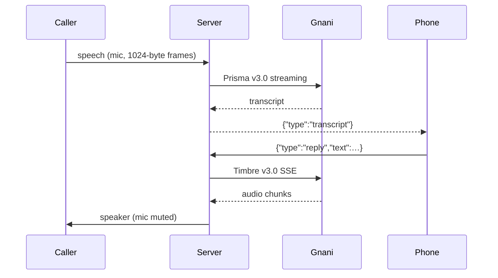

<!--
Keep the sections that apply and delete the rest — never pad with "n/a".

One PR per logical change, short-lived branch `type/scope` (feat/, fix/, chore/,
docs/), Conventional Commits, squash-merge and delete.
`Closes #N` only auto-closes the issue when the PR targets the default branch: if
you stack PRs, retarget the next one to `main` after this merges, or link the
issue by hand.
-->

# Why

<!-- The problem in behaviour-facing terms: what did a user see, and what should they see?
     For anything touching audio or metrics, say which of these it is:
     - a bug the user hears (wrong text, echo, cut-off)
     - a measurement bug (the number was wrong, not the system)
     - a missing capability the demo needs -->

# What changed

<!-- The smallest useful change, the commit list, and anything deliberately left unchanged. -->

# Visuals

<!-- One diagram beats three. Mermaid renders in the PR body — pick the shape that fits:
     sequenceDiagram (a flow through several actors: mic → server → Gnani → speaker),
     flowchart (state/branches), stateDiagram-v2 (a lifecycle: idle → listening → speaking),
     erDiagram (schema — there is none here, so probably not). -->

# Validation and proof

<!-- check → exact command → actual result. Quote real numbers, not adjectives.
     If a number in README or docs changed, show the before → after. -->

| Check | Command | Actual result |
| --- | --- | --- |
| Web type-check + build | `cd pashyanti/web && bun run build` | tsc clean; built in NNN ms, NN kB gzipped |
| Server boots | `cd pashyanti/backend && uv run python server.py` | `GET /` 200; `/ws` returns `hello` with `mic: true` |
| Streaming protocol | `uv run python test_stream_file.py smoke.wav` | transcript returned, latency NN ms |
| Phone-line accuracy | `uv run python -m harness.cli` | WER clean 0.0% → 10 dB SNR X.X% (was Y.Y%) |

# UI proof

<!-- Embed the screenshots, do not just link a path — a bare path is not an image.
     Relative paths only resolve inside the repository tree, so in a PR body use a full URL.
     Pin a commit (not a branch) so the image survives the branch being deleted:

     

     The same files stay at docs/screenshots/ on main after merge. For layout
     changes, include the phone view (fullscreen PWA) as well as the desktop one. -->

# Risk and rollback

- **Risk:** … (be specific: what breaks, for whom — e.g. "barge-in stays impossible",
  "8 kHz path gets noisier", "harness numbers move if the corpus changes")
- **Rollback:** revert the commit. `pashyanti/backend/cache/` is disposable and
  gitignored, so no data migration is ever involved.

## Checklist

- [ ] `bun run build` green (type-check + build)
- [ ] server boots and `/ws` returns `hello`
- [ ] the harness numbers in `README.md` and `pashyanti/backend/README.md` match
      the current `harness_report.json` (or the PR says why they moved)
- [ ] no API key, `.env`, phone number, Aadhaar/PAN or real call recording in the diff
- [ ] no new dependency without a stated reason
- [ ] `AGENTS.md`, `pashyanti/docs/*.md` and `README.md` updated when behaviour,
      a hard constraint or the workflow changed
- [ ] screenshots are embedded (not just linked) and the diagram is accurate
- [ ] any claim about translation, diarization or call recording is still absent —
      none of the three exist

**Not verified:** <!-- say plainly what you could not check on this machine and why,
e.g. "no microphone in this container, so capture was verified only by replaying a wav" -->
