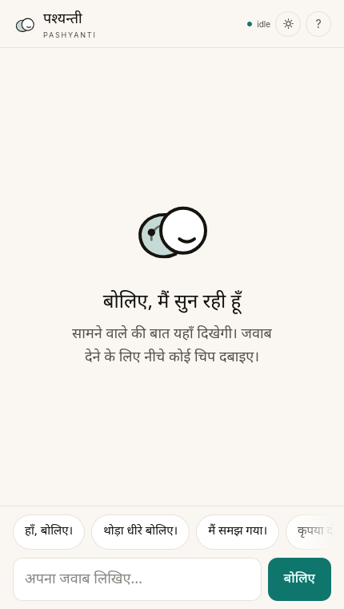
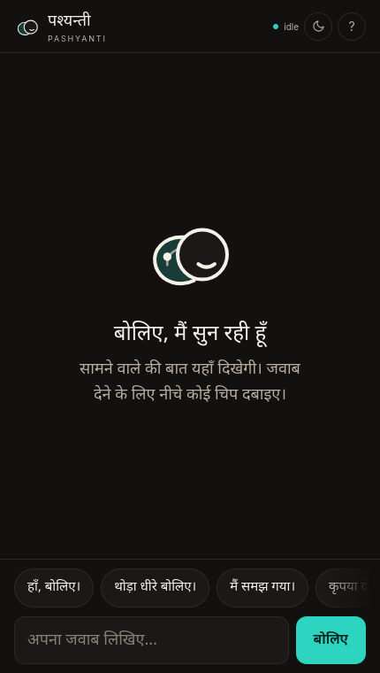

# Pashyanti

> *before the word, the vision*

[](https://github.com/Goutam-11/pashyanti/actions/workflows/ci.yml)

A phone assistant for people who **can't hear**, **can't speak**, or **both**.

Roughly one in twelve Indians lives with disabling hearing loss, and millions more
cannot speak — after a laryngectomy, a stroke, ALS, cerebral palsy, or from birth.
For them a phone call is a closed door: the doctor, the bank, the school, the
government office all assume a voice at both ends.

Pashyanti opens the door from both sides.

| Mode | For | What happens |
|---|---|---|
| **Suniye** *(listen)* | People who can't hear | The other person's speech appears as large live text on screen. The user taps or types a reply, and it is spoken back down the line. |
| **Boliye** *(speak)* | People who can't speak | The user taps or types; a natural Indian voice speaks for them — optionally in **their own cloned voice**, from 20 seconds of reference audio. |

Every call ends in a **summary card**: who called, what was agreed, what happens next.

## Why the name

Sanskrit grammar describes speech in four stages — *para → pashyanti → madhyama → vaikhari*.
**Pashyanti** is the second: the stage where language is seen, not heard, and word
and meaning are still one. Deaf people have always lived at pashyanti. This project
just gives them a screen.

## Built on

| Layer | Model | Role |
|---|---|---|
| Ears | **Gnani Prisma v3.0** | Speech → text. Nine Indian languages + English, automatic language detection, code-mixed speech, `keyterms` hints |
| Mouth | **Gnani Timbre v3.0** | Text → speech. 13 voices × 10 languages, 13 inline emotion tags |
| Identity | **Gnani voice clone** | 5–30 s of reference audio → the user's own voice |

## Honest engineering notes

- Gnani's API exposes speech models only — **no PSTN/SIP, no phone numbers**. The
  audio path is therefore built in two stages: synthetic 8 kHz telephony first
  (band-limited, µ-law round-tripped, noisy), then a real Twilio Media Streams
  bridge if time allows. This is stated plainly in the demo rather than hidden.
- Realtime STT takes **raw PCM s16le, mono, exactly 1024-byte frames**, at
  real-time cadence. It returns one transcript per closed VAD segment — there are
  no interim words.
- No word-level timestamps and no live diarization. Diarization exists only in the
  Batch API.
- Overlapping speech breaks it. The system asks callers to repeat rather than
  guessing, and the limitation is shown on screen.

## Measured, not asserted

`pashyanti/backend/harness/` synthesises eight clips from known text, degrades
them to what a phone line actually does — 300–3400 Hz band-limit, 8 kHz
resample, G.711 µ-law quantisation, background noise — and measures word error
rate against the known reference. No hand labelling, no clean-mic fiction.

| audio | WER | CER |
|---|---|---|
| clean 16 kHz | **0.0%** | 0.0% |
| phone line, 10 dB SNR | **3.6%** | 2.9% |
| phone line, 5 dB SNR | 27.8% | 23.0% |
| phone line, 0 dB SNR | 93.5% | 88.9% |

10 dB is a noisy street; 0 dB is speech buried under noise, where the system
asks the caller to repeat rather than guessing. Reproduce with:

```fish
cd pashyanti/backend && uv run python -m harness.cli
```

## Run it

Two parts: a Python backend that owns the audio, and a React frontend you can
install to a phone's home screen.

```fish
# backend
cd pashyanti/backend
cp .env.example .env          # paste your GNANI_API_KEY
uv sync
uv run python server.py       # http://localhost:8080

# frontend, hot reload
cd pashyanti/web
bun install
bun run dev                   # http://localhost:5173, proxies /ws to :8080
```

For production the backend serves `web/dist` itself — one `bun run build`, then
one process on one port. Open it on a phone over the LAN, "Add to Home Screen",
and it runs fullscreen like an app.

| Piece | What it does |
|---|---|
| `pashyanti/backend/server.py` | The app: serves the frontend, runs the microphone, relays Gnani |
| `pashyanti/backend/stt.py` | Mic → Prisma v3.0 streaming → one callback per sentence |
| `pashyanti/backend/tts.py` | Text → Timbre v3.0 SSE → speaker, cached by hash |
| `pashyanti/backend/audio.py` | 1024-byte frame maths, G.711 µ-law in numpy |
| `pashyanti/backend/probe.py` | What a credit is worth: one 1,000-char TTS + one 10 s STT call |
| `pashyanti/backend/stream_mic.py` | Standalone mic → transcript, for testing the socket |
| `pashyanti/backend/test_stream_file.py` | Replays a wav into the STT socket — no microphone needed |
| `pashyanti/backend/clone_voice.py` | `build ref.wav` → embedding, then `say "..."` in that voice |
| `pashyanti/web/` | Vite + React + TypeScript, vanilla CSS, no UI framework |

## Screens

| | |
|---|---|
|  |  |
|  | |

Paper & Ink, light by default. The mascot — Sakhi — is the state indicator:
her ear pulses while listening, her mouth moves while speaking.

## Documentation

| Document | What is in it |
|---|---|
| [`AGENTS.md`](AGENTS.md) | The contract for AI coding agents: hard constraints, commands, conventions, what not to add |
| [`pashyanti/docs/ARCHITECTURE.md`](pashyanti/docs/ARCHITECTURE.md) | Topology, request path, module ownership, WebSocket protocol, latency budget |
| [`pashyanti/docs/API-NOTES.md`](pashyanti/docs/API-NOTES.md) | Verified Gnani API behaviour, including the traps |
| [`pashyanti/docs/DECISIONS.md`](pashyanti/docs/DECISIONS.md) | Why the stack is what it is, and what each choice costs |

## Status

Hackathon build — *The Great Indian AI Internship Challenge*, November 2026.
Working: live transcription, spoken replies, voice cloning, phone-line accuracy
measurement, installable frontend. In progress: the summary card and the Twilio
Media Streams bridge.

## License

MIT
