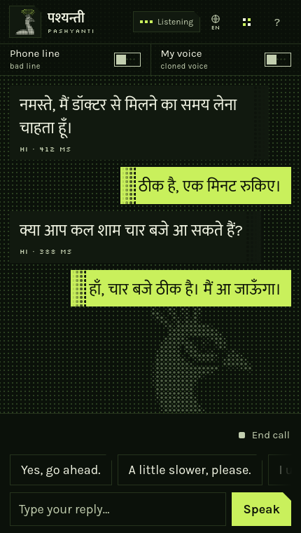
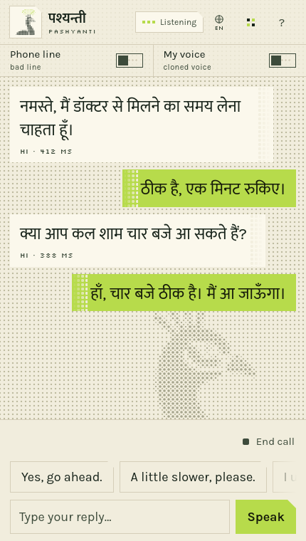
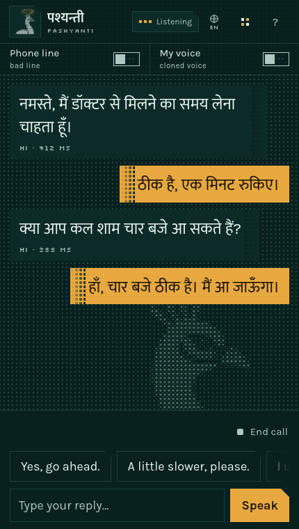
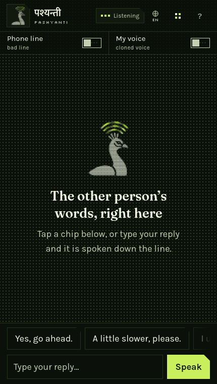
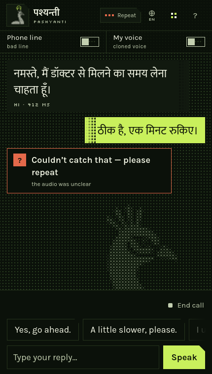
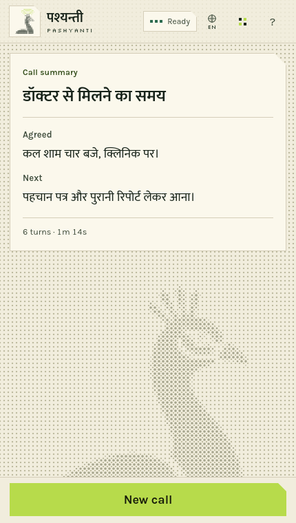
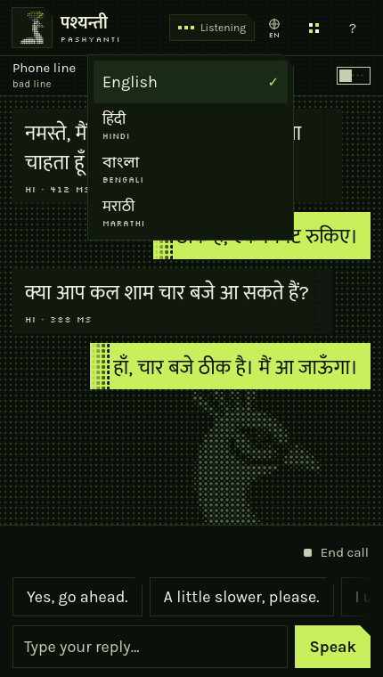
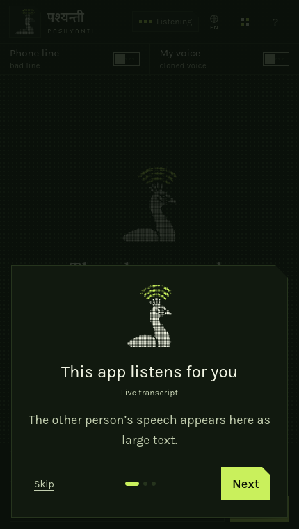

# Pashyanti

> *before the word, the vision*

[](https://github.com/Goutam-11/pashyanti/actions/workflows/ci.yml)

A phone assistant for people who **can't hear**, **can't speak**, or **both**.

Roughly one in twelve Indians lives with disabling hearing loss, and millions more
cannot speak — after a laryngectomy, a stroke, ALS, cerebral palsy, or from birth.
For them a phone call is a closed door: the doctor, the bank, the school, the
government office all assume a voice at both ends.

Pashyanti opens the door from both sides.

| Mode | For | What happens |
|---|---|---|
| **Suniye** *(listen)* | People who can't hear | The other person's speech appears as large live text on screen. The user taps or types a reply, and it is spoken back down the line. |
| **Boliye** *(speak)* | People who can't speak | The user taps or types; a natural Indian voice speaks for them — optionally in **their own cloned voice**, from 20 seconds of reference audio. |

Every call ends in a **summary card**: who called, what was agreed, what happens
next. The card is computed from the transcript and appears instantly; a model
then rewrites those three lines from the same text, in the interface language,
about two seconds later — the first card is the fallback.

## Why the name

Sanskrit grammar describes speech in four stages — *para → pashyanti → madhyama → vaikhari*.
**Pashyanti** is the second: the stage where language is seen, not heard, and word
and meaning are still one. Deaf people have always lived at pashyanti. This project
just gives them a screen.

## Built on

| Layer | Model | Role |
|---|---|---|
| Ears | **Gnani Prisma v3.0** | Speech → text. Nine Indian languages + English, automatic language detection, code-mixed speech, `keyterms` hints |
| Mouth | **Gnani Timbre v3.0** | Text → speech. 13 voices × 10 languages, 13 inline emotion tags |
| Identity | **Gnani voice clone** | 5–30 s of reference audio → the user's own voice |

## Honest engineering notes

- Gnani's API exposes speech models only — **no PSTN/SIP, no phone numbers**. The
  demo's audio path is the synthetic 8 kHz phone line (band-limited, µ-law
  round-tripped, noisy); the real-call bridge is a separate build. A throwaway
  bridge on an **Exotel trial Indian number** was tested end to end on 14 Nov: a
  real mobile call reached the server, Prisma v3.0 transcribed two
  Hindi/code-mixed turns, and Timbre v3.0's reply was heard on the handset. It
  is not in the video: a trial number is not judge-dialable (limited inbound,
  unknown callers may hit a PIN) and the app page is not wired to it
  ([`EXOTEL-SPIKE.md`](pashyanti/docs/EXOTEL-SPIKE.md)). The Twilio spike remains
  a no-go for this deadline
  ([`TWILIO-SPIKE.md`](pashyanti/docs/TWILIO-SPIKE.md)).
- Realtime STT takes **raw PCM s16le, mono, exactly 1024-byte frames**, at
  real-time cadence. It returns one transcript per closed VAD segment — there are
  no interim words.
- No word-level timestamps and no live diarization. Diarization exists only in the
  Batch API.
- Overlapping speech breaks it. The system asks callers to repeat rather than
  guessing, and the limitation is shown on screen.
- Reply chips are generated per utterance in the caller's detected language by
  a small model (`deepseek-v4.1-flash` over OpenCode), **2.5 s after the
  transcript** and never blocking the call: if it is slow or unavailable the
  static chips stay. The chips are only as right as the detected language — a
  synthetic Bengali clip was labelled `bn-IN` once and `mr-IN` once — and the
  model can be blunt or use the wrong grammatical gender. It is a suggestion,
  not a script; the composer is there to edit it
  ([`LLM-NOTES.md`](pashyanti/docs/LLM-NOTES.md)).

## Measured, not asserted

`pashyanti/backend/harness/` synthesises eight clips from known text, degrades
them to what a phone line actually does — 300–3400 Hz band-limit, 8 kHz
resample, G.711 µ-law quantisation, background noise — and measures word error
rate against the known reference. No hand labelling, no clean-mic fiction.

| audio | WER | CER |
|---|---|---|
| clean 16 kHz | **0.0%** | 0.0% |
| phone line, 10 dB SNR | **3.6%** | 2.9% |
| phone line, 5 dB SNR | 27.8% | 23.0% |
| phone line, 0 dB SNR | 93.5% | 88.9% |

10 dB is a noisy street; 0 dB is speech buried under noise, where the system
asks the caller to repeat rather than guessing. Reproduce with:

```fish
cd pashyanti/backend && uv run python -m harness.cli
```

**Bengali, provisional.** A second corpus (`bn-IN`, ten sentences) is measured
the same way:

| audio | WER | CER |
|---|---|---|
| clean 16 kHz | 3.7% | 0.7% |
| phone line, 10 dB SNR | 8.7% | 4.5% |

The Bengali reference was written in Bengali rather than translated from the
Hindi list, but **no native speaker has checked it**, so this figure is
provisional (#12). Do not read it as a language comparison with the Hindi row:
`wer.normalize` folds Devanagari orthography only (`DECISIONS.md` D-015), so
`পাঁচশো/পাঁচশ` and `এখনো/এখনও` count as errors in Bengali and would not in
Hindi. Reproduce with:

```fish
cd pashyanti/backend && uv run python -m harness.cli --lang bn-IN -n 10 --levels 10
```

## Run it

Two parts: a Python backend that owns the audio, and a React frontend you can
install to a phone's home screen.

```fish
# backend
cd pashyanti/backend
cp .env.example .env          # paste your GNANI_API_KEY
uv sync
uv run python server.py       # http://localhost:8080

# frontend, hot reload
cd pashyanti/web
bun install
bun run dev                   # http://localhost:5173, proxies /ws to :8080
```

For production the backend serves `web/dist` itself — one `bun run build`, then
one process on one port. Open it on a phone over the LAN, "Add to Home Screen",
and it runs fullscreen like an app.

### Conversation mode — the phone is the microphone

The path above hears the caller through the **server's** microphone, which is
what the demo video uses. **Talk mode** (`?mode=talk`) is for when the laptop is
not there: the user holds the phone between themselves and another person in the
same room, the page captures 16 kHz PCM in an AudioWorklet and sends it as whole
1024-byte frames, and Timbre's reply is streamed back for the phone's speaker.
The server is only a relay and opens no audio device.

```fish
ngrok http 8080          # getUserMedia needs a secure context
# on the phone: https://<random>.ngrok-free.dev/?mode=talk
```

`getUserMedia` needs `https://` (or `localhost`), so a tunnel or
`server.py --tls cert.pem key.pem` is required. Half-duplex is preserved on both
sides: the server sends silence while it streams and the page stops sending
frames until the reply has played. Measured in a real Chrome over the HTTPS
tunnel with a fake microphone device: **585 frames, every one exactly 1024
bytes, median cadence 32 ms**, a `hi-IN` transcript on screen, and the reply
back as 17 chunks / 1.36 s of PCM. The runbook, the full numbers and everything
that was **not** verified (no physical phone, no room acoustics, no iOS) are in
[`pashyanti/docs/TALK-MODE.md`](pashyanti/docs/TALK-MODE.md).

| Piece | What it does |
|---|---|
| `pashyanti/backend/server.py` | The app: serves the frontend, runs the microphone, relays Gnani |
| `pashyanti/backend/stt.py` | Mic (or the page's frames) → Prisma v3.0 streaming → one callback per sentence |
| `pashyanti/backend/tts.py` | Text → Timbre v3.0 SSE → speaker or the page, in the caller's language, cached by hash |
| `pashyanti/backend/llm.py` | One contextual reply chip per transcript, best-effort |
| `pashyanti/backend/audio.py` | 1024-byte frame maths, G.711 µ-law in numpy |
| `pashyanti/backend/probe.py` | What a credit is worth: one 1,000-char TTS + one 10 s STT call |
| `pashyanti/backend/stream_mic.py` | Standalone mic → transcript, for testing the socket |
| `pashyanti/backend/test_stream_file.py` | Replays a wav into the STT socket — no microphone needed |
| `pashyanti/backend/clone_voice.py` | `build ref.wav` → embedding, then `say "..."` in that voice |
| `pashyanti/web/talk.ts` | AudioWorklet capture (16 kHz, 1024-byte frames) + Web Audio reply playback |
| `pashyanti/web/` | Vite + React + TypeScript, Tailwind 4 + CSS tokens, no component library |

## Screens

| | |
|---|---|
|  |  |
|  |  |
|  |  |
|  |  |

The surface is a halftone dot screen, not a sheet of paper: a 6 px lattice is
the ground, every panel is a flat hole punched in it, and a bubble's edge
dissolves into ground-coloured dots instead of ending in a border. Three grounds
ship and are selectable from the header (D-016): **Peacock** (default) —
near-black `#0B110A`, bone ink `#F2F5E4`, acid signal `#C9F05C`, body text
17.3:1; **Lime Wash** — bone `#F1EDDD`, green-black ink `#17231A`, lime signal
`#B7DB4B`, 13.9:1; **Slate** — deep teal `#08201E`, mint ink `#E7F3EE`, gold
signal `#E7A93F`, 14.9:1.

The mascot — Sakhi, a peacock — is the traced mark from
[`peacock-identity.png`](pashyanti/docs/screenshots/peacock-identity.png),
rasterised from those exact paths into a dot-matrix sprite: the three sound arcs
stay still at idle and pulse while listening, the beak opens while speaking, and
a `?` disc appears when the words were missed. The same head is ghosted into the
lower field on the field's own lattice — static, and hidden behind the empty
state, because the mascot is the only state indicator. The app icon is the same
bird.

The interface ships in **English (default), हिंदी, বাংলা and मराठी**, with a
globe picker in the header. The recogniser is multilingual (`indic-auto`: nine
Indic languages + English), so the caller's language does not depend on the UI
language — and the reply follows **the caller**: Timbre is asked for the
detected language, and the reply chips are written in it, with "please repeat"
and "a little slower" from a reviewed table in eleven languages. The cloned
voice is Hindi-only (the clone endpoint takes an embedding, not a language), so
a non-Hindi reply uses the default Timbre voice.

## Documentation

| Document | What is in it |
|---|---|
| [`AGENTS.md`](AGENTS.md) | The contract for AI coding agents: hard constraints, commands, conventions, what not to add |
| [`pashyanti/docs/ARCHITECTURE.md`](pashyanti/docs/ARCHITECTURE.md) | Topology, request path, module ownership, WebSocket protocol, latency budget |
| [`pashyanti/docs/API-NOTES.md`](pashyanti/docs/API-NOTES.md) | Verified Gnani API behaviour, including the traps |
| [`pashyanti/docs/DECISIONS.md`](pashyanti/docs/DECISIONS.md) | Why the stack is what it is, and what each choice costs |
| [`pashyanti/docs/LLM-NOTES.md`](pashyanti/docs/LLM-NOTES.md) | The chip model: endpoint facts, the reasoning-model latency finding, prompts, limits |
| [`pashyanti/docs/DEMO.md`](pashyanti/docs/DEMO.md) | The 60-second shoot script: beat sheet, shot list, the numbers and their provenance, post copy |
| [`pashyanti/docs/TWILIO-SPIKE.md`](pashyanti/docs/TWILIO-SPIKE.md) | The Twilio Media Streams spike: what a real phone call would take, and why it is not in the demo |
| [`pashyanti/docs/EXOTEL-SPIKE.md`](pashyanti/docs/EXOTEL-SPIKE.md) | The Exotel trial-call spike: one real Indian call that worked, and why it is still not the video |
| [`pashyanti/docs/TALK-MODE.md`](pashyanti/docs/TALK-MODE.md) | Conversation mode: the phone as microphone and speaker, the HTTPS requirement, the measured evidence and its limits |

## Status

Hackathon build — *The Great Indian AI Internship Challenge*, November 2026.
Working: live transcription, spoken replies in the caller's language,
contextual reply chips, voice cloning, phone-line accuracy measurement,
installable frontend, an interface in English, Hindi, Bengali and Marathi, and
conversation mode with the phone as the microphone and speaker (`?mode=talk`,
over HTTPS). The end-of-call summary card (#4), the repeat notice (#3) and both demo
switches — *फ़ोन लाइन* / Phone line (#5) and *मेरी आवाज़* / My voice (#6) — are
live end to end. Not built: a real phone number — the Twilio spike is a
documented no-go for this deadline.

## License

MIT
